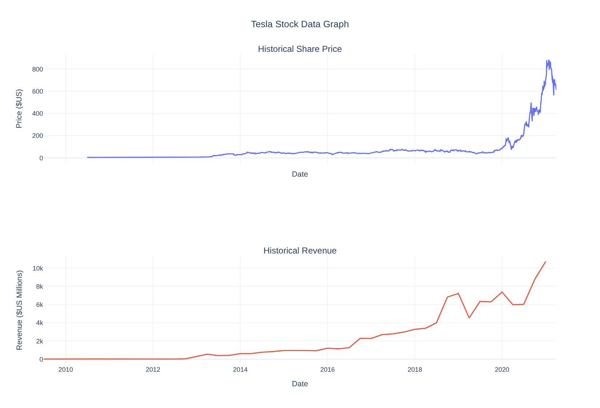
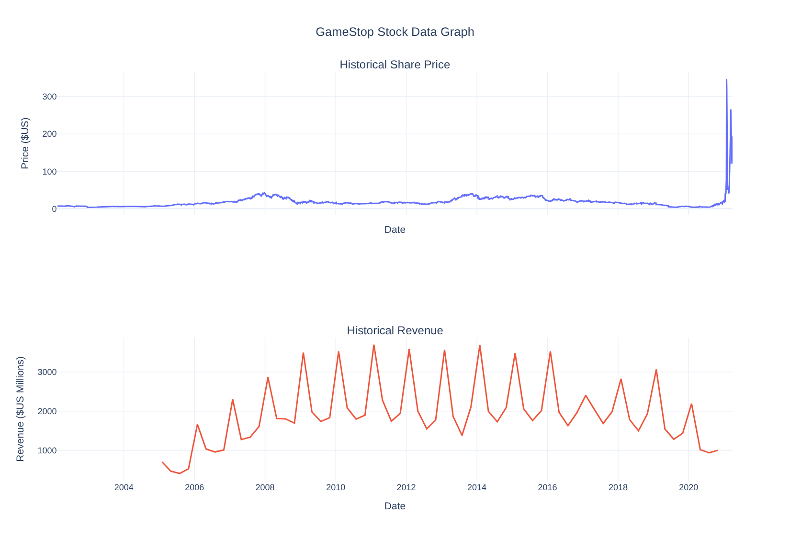

# 📈 Extracting and Visualizing Stock Data

Comparing **share price vs. company revenue** for **Tesla (TSLA)** and **GameStop (GME)**: stock prices pulled with the `yfinance` API, quarterly revenue scraped from the web, and both combined into interactive Plotly dashboards.


> Final project for the **IBM "Python Project for Data Science"** course (Coursera). The data snapshot runs up to early 2021.

---

## 🎯 What it does

1. **Extracts stock prices** for Tesla and GameStop with `yfinance` (full history, daily).
2. **Scrapes quarterly revenue** tables from [macrotrends.net](https://www.macrotrends.net/) using `requests` + `BeautifulSoup` / `pandas.read_html`.
3. **Cleans the data**: renames columns, strips `$` and `,` from revenue values, drops empty rows.
4. **Builds a two-panel dashboard** for each company: share price on top, revenue below, on a shared time axis.

---

## 📊 Results

### Tesla



Revenue grows steadily from 2016 onward, and the share price takes off in 2020 as revenue passes $10B per quarter. Price and fundamentals move in the same direction, though the price rises much faster.

### GameStop



Two things stand out:
- **Strong seasonality:** revenue spikes every Q4 (holiday sales), then drops back.
- **Price disconnected from revenue:** revenue was declining after 2019, yet the share price exploded in **January 2021** during the retail-investor short squeeze. A clear example of a price driven by market sentiment rather than business performance.

---

## 🗂️ Project structure

```
.
├── notebooks/
│   └── stock_revenue_dashboard.ipynb   # full analysis
├── images/                             # dashboard snapshots used in this README
├── requirements.txt
└── README.md
```

---

## 🚀 Run it yourself

```bash
git clone https://github.com/sina-778/ExtractingandVisualizingStockData.git
cd ExtractingandVisualizingStockData
pip install -r requirements.txt
jupyter notebook notebooks/stock_revenue_dashboard.ipynb
```

> ⚠️ **Note:** macrotrends.net may now block plain scripted requests, so the scraping cells can fail when re-run. The saved outputs in the notebook still show the original results. Adding a browser `User-Agent` header to `requests.get(...)` often helps.

---

## 🧠 What I learned

- Pulling financial time series through an API (`yfinance`)
- Scraping and parsing HTML tables with `BeautifulSoup` and `pandas.read_html`
- Cleaning messy text values into numeric data
- Building multi-panel, interactive charts with Plotly

---

## 🙏 Acknowledgements

Assignment template and graphing function provided by **IBM Skills Network** as part of the *Python Project for Data Science* course.
